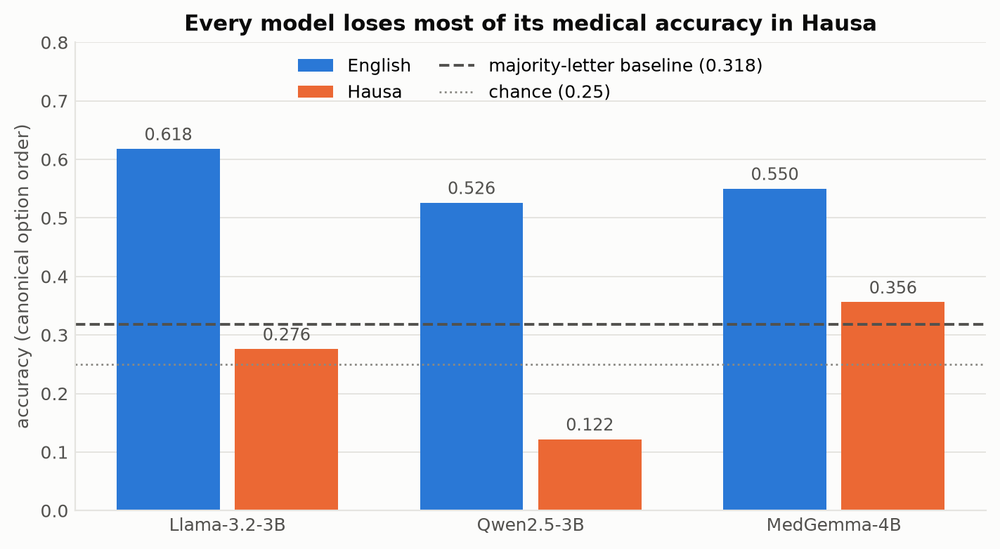

# Hausa Medical QA: does medical reasoning in small LLMs survive translation into Hausa?

A pre-registered pilot measuring how much accuracy and answer stability small open LLMs lose when medical multiple-choice questions are asked in Hausa rather than English, where that loss comes from, and whether a small DPO intervention recovers any of it.

The hypotheses (H1–H4), decision rules, and analysis plan are fixed in [`PREREGISTRATION.md`](PREREGISTRATION.md) before any model is evaluated.

**Frozen at commit `66d3f1d` ("Freeze pre-registration"), 2026-09-24 16:37 +0100.** That commit sets the `FROZEN` status in `PREREGISTRATION.md`; the hash was written back into this README by the next commit, `9fac87b`, because a commit cannot contain its own hash. An earlier version of this line cited `6bb50a1` in error — that commit is "changes for translate.py file", made five hours before the freeze.

Supporting provenance, all checkable with `git log`:

- [`src/stats.py`](src/stats.py), which contains every decision rule and statistical test, is byte-identical to its first commit (`68b1640`, 2026-09-23) and has not been modified since — before any translation or model run.
- Baseline evaluation started 2026-09-25 15:21 +0100 (`results/eval_run_log.json`) with [`src/evaluate.py`](src/evaluate.py) already committed at `cd35807` (2026-09-24 18:01).
- Four deviations after freezing are logged in `PREREGISTRATION.md` § 13, each with its date and the reason it was made.


## Status

- [x] 01 · Data preparation (sampling, repair, translation)
- [x] 01b · Translation quality check, review of flagged segments, rater sheets
- [x] Human validation of translations (75 items, 2 raters)
- [x] Pre-registration frozen
- [x] 02 · Baseline evaluation (H1–H3)
- [x] 02b · E1 error analysis (exploratory) — re-coded under deviation 5; single-coder plus a verification pass
- [x] 03a · H4 pilot gate — run; **stop**. Parse rate 0.400, projected 122 pairs against a floor of 200, implied skill rate zero
- [·] 03 · DPO intervention (H4) — **not run**, on the gate's evidence (`results/h4_pilot_gate.json`). Reported as such, not dropped
- [x] 04 · Analysis and figures — five figures, three paper tables, and paper/numbers.tex
- [ ] Report — paper/main.tex drafted, H1–H4 and related work written; needs authors, a speaker-count source, and the acknowledgements

## Results so far (H1–H3)



Regenerate every figure and table with `notebooks/04_analysis_and_figures.ipynb`, or
`python -c "from src import figures as F; F.all_figures(F.load())"` — neither needs a GPU.

Three models, n = 500 paired items, zero-shot, greedy decoding, answer-letter parsing, unparseable scored as incorrect. Full numbers in [`results/baseline_results.json`](results/baseline_results.json); run provenance in [`results/eval_run_log.json`](results/eval_run_log.json).

**Accuracy in the canonical option order (`p0`).** The pre-registered "always pick the most common letter" baseline for this order is **0.318**.

| Model | EN | HA | HA→EN | EN − HA | HA vs. letter baseline |
|---|---|---|---|---|---|
| Llama-3.2-3B-Instruct | 0.618 | 0.276 | 0.450 | +34.2 pp | −4.2 pp |
| Qwen2.5-3B-Instruct | 0.526 | 0.122 | 0.392 | +40.4 pp | −19.6 pp |
| MedGemma-4B-IT | 0.550 | 0.356 | 0.402 | +19.4 pp | +3.8 pp |

Asked in Hausa, none of the three models is meaningfully better than always answering the most common letter, and two are worse than it. Qwen's figure is depressed by format failure: only 47% of its Hausa outputs could be parsed, and unparseable counts as incorrect, as pre-registered. Under robust accuracy (correct in all three option orderings) the Hausa figures are 0.088, 0.034 and 0.188.

- **H1 — language gap: supported for all three models.** Holm-adjusted exact McNemar p < 1e−12 throughout; every paired-bootstrap CI excludes zero.
- **H2 — translate-test recovers ≥ half the gap: supported for Llama (0.509) and Qwen (0.668), not supported for MedGemma** (0.237, p = 0.073).
- **H3 — robustness gap: supported for all three.** Semantic consistency EN → HA: Llama 0.670 → 0.210, Qwen 0.676 → 0.084, MedGemma 0.578 → 0.408.

**Where these conclusions are fragile.** Both of the following are pre-registered analyses that disagree with the primary one, and are recorded here rather than left to be found:

- Llama's H2 clears the threshold by 0.009 (recovery 0.509 against a 0.50 rule) and **flips to not-supported** under sensitivity analysis (b), which drops items with any option kept in English: 0.436.
- Qwen's H2 **flips to not-supported** under the secondary letter-probability scoring: 0.489.

**Gap averaged over all three option orderings** rather than the canonical order alone. H1 is pre-registered on `p0`, and `p0` happens to be the worst Hausa ordering for Llama (0.276, against 0.342 and 0.312), so the single-order gap overstates that model's loss:

| Model | EN mean | HA mean | gap |
|---|---|---|---|
| Llama-3.2-3B-Instruct | 0.608 | 0.310 | 29.8 pp |
| Qwen2.5-3B-Instruct | 0.521 | 0.126 | 39.5 pp |
| MedGemma-4B-IT | 0.554 | 0.373 | 18.1 pp |

### E1 error analysis (exploratory, re-coded under deviation 5)

Why do models answer an item correctly in English and wrongly in Hausa? 50 such discordant items
— 25 from Llama, 25 from MedGemma, drawn with a fixed seed before any coding — were coded into the
four pre-registered categories under [`data/e1_codebook.md`](data/e1_codebook.md): written
definitions, a mandatory note per row, and six rules the sheet enforces, two of which reject a
coded segment whose Hausa is identical to its English, or that sits on an option that is neither
the gold answer nor the model's choice. Pooled over both models (primary; per-model figures are
descriptive only, because the re-code was unblinded):

| category | n | proportion | 95% CI |
|---|---|---|---|
| medical-term loss | 29 | 0.58 | 0.44–0.71 |
| reasoning failure | 14 | 0.28 | 0.17–0.42 |
| translation error | 5 | 0.10 | 0.04–0.21 |
| option-format failure | 2 | 0.04 | 0.01–0.14 |

Of the 34 text errors, **18 sit on the question stem**, 10 on the option the model chose and 6 on
the gold option; 19 of those segments had passed human review and 15 had not. No row was
unparseable — Llama and MedGemma, the two models E1 samples, both parse at 1.00 in Hausa — so
format failure here means a broken option surface, not a model that could not answer. (Qwen is the
exception and is not in E1: it parses only 0.47 of its Hausa answers, which is a different failure
and is reported with the baseline results.) Separately, 22 of the 50 rows carry at
least one option whose Hausa is byte-identical to its English (1.14 per row on average): a medical
term carried over untranslated cannot itself cause the discordance, and it is recorded as a
descriptive covariate rather than as translation damage.

**Reliability: this is single-coder coding with a verification pass, and no κ is claimed.**
Deviation 5 planned independent double coding. What was carried out is weaker: coder 1 coded all
50 rows, and coder 2 — a second native Hausa speaker — then reviewed coder 1's completed sheet
row by row against the same codebook, confirming or correcting each row. Coder 2 confirmed every
code and segment and reworded most notes, so both sheets validate cleanly and agree 50/50, but
that figure is a confirmation rate, not inter-coder reliability. The repository evidences this
rather than asserting it: `e1.note_similarity` measures how alike the two sheets' free-text notes
are, finds a median similarity of 0.90 with 22 of 50 near-identical, and `summarise` stamps the
agreement block with `not_a_reliability_estimate`. **Report E1 as single-coder coding under a
written codebook with machine-enforced consistency rules, plus a second-reader verification pass.
Do not report κ or raw agreement as reliability.** `data/e1_coding_coder2.csv` is released blank,
so an independent second coder can still be recruited and the figures recomputed in seconds.

The first pass is superseded and **its proportions are not citable**; its sheet and summary are
retained as [`results/e1_coding_v1_superseded.csv`](results/e1_coding_v1_superseded.csv) and
`results/e1_summary_v1_superseded.json` for comparison. Of its 29 text-error rows, 10 named a
segment identical in both languages (`Placenta`, `CMV`, `Warfarin`, `Atopy`, `AFP`, …) and 13 named
an option that was neither gold nor chosen — 20 failed at least one check, leaving 9 sound — and no
row carried a note. Its headline "40% medical-term loss" rested on 6 defensible rows. The same
rules run over that sheet today reject it on 50 counts of R2, 10 of R4 and 13 of R5. Note also that
the first pass placed **no** error on the question stem, where the re-code places 18 of 34.

See `PREREGISTRATION.md` § 13, deviation 5, committed before any row was re-coded. The sample, its
seed and the four categories are unchanged. E1 remains exploratory with no hypothesis attached.

## Layout

```
PREREGISTRATION.md          hypotheses, decision rules, analysis plan
src/config.py               all fixed settings (seed, sizes, filters, models)
src/data.py                 filtering, stratified sampling, disjointness, records
src/translate.py            resumable NLLB-200 translation with passthrough/retry/fallback
src/qe.py                   round-trip quality check and review-sheet handling
src/evaluate.py             prompts, generation, answer parsing, letter-probability scoring
src/stats.py                McNemar, paired bootstrap, Holm, H1–H4 decision rules
src/e1.py                   E1 sampling, coding sheet, validation, summary
src/dpo.py                  H4 CoT sampling, preference pairs, pilot gate
src/figures.py              report figures and paper tables (no Drive, no GPU)
src/paper.py                emits paper/numbers.tex from results; checks the paper's macros
paper/main.tex              the manuscript; every number is a macro, none typed by hand
paper/numbers.tex           generated — do not edit
notebooks/01_data_preparation.ipynb
notebooks/01b_translation_qe.ipynb
notebooks/02_baseline_evaluation.ipynb
notebooks/02b_error_analysis.ipynb
notebooks/03a_dpo_pilot.ipynb
notebooks/04_analysis_and_figures.ipynb
tests/preflight_h4.py       non-GPU pre-flight for the H4 gate; run before booking a GPU
data/README.md              provenance, licence and attribution for the released sheets
results/                    small committed outputs (manifests, metrics)
results/figures/            figures as PNG and PDF, plus the paper tables as CSV
```

Large artefacts (datasets, translations, model outputs) live on Google Drive under `hausa-med-qa/` and are not committed. `results/data_manifest.json` records their SHA-256 hashes.

## Running

Open each notebook in Colab with a GPU runtime and run top to bottom. Every stage caches to Drive and resumes after a disconnect.

## Data and scope

Questions come from MedMCQA. Its publishers attach two different licences — the source
project [github.com/MedMCQA/MedMCQA](https://github.com/MedMCQA/MedMCQA) is MIT, while the Hugging
Face card carries `license: apache-2.0` and leaves its "Licensing Information" section an unfilled
placeholder. Both are permissive and permit redistribution of derived text with attribution, so
the human-annotation sheets are released under [`data/README.md`](data/README.md), which carries
the attribution and the MedMCQA citation.

**The binding constraint is not MedMCQA but the translator.** The Hausa text was produced with
NLLB-200-3.3B, which is CC-BY-NC-4.0, so the paired EN–HA set is **non-commercial use only** —
stricter than either MedMCQA licence. Anyone needing a commercially usable Hausa set must
retranslate with a permissively licensed model; `src/translate.py` and the manifest make that
reproducible.

This is a capability evaluation, not a clinical validation; no model here should be used for
medical advice.
